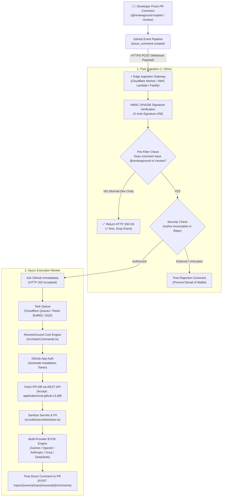

# ReviewGround - GitHub App & Webhook Backend Service Architecture

## 1. Executive Summary & Vision

Today, **ReviewGround** operates as a zero-dependency **GitHub Action** running on ephemeral GitHub-hosted runners (`ubuntu-latest`). While this provides maximum privacy (code never leaves the user's repository) and zero hosting overhead for the maintainers, it introduces a compute startup latency (~10–25s runner spin-up) on PR comments.

This document outlines the production blueprint for an optional **GitHub App / Serverless Webhook Service**. In this model, incoming PR comments and reviews are intercepted at the edge in **< 10ms**, evaluating commands and streaming AI responses without consuming any GitHub Actions runner minutes.

```
┌──────────────────────────────────────────────────────────────────────────┐
│                   GitHub Action vs. GitHub App Comparison                │
├──────────────────────┬─────────────────────────┬─────────────────────────┤
│ Metric               │ GitHub Action (Current) │ GitHub App (Future SaaS)│
├──────────────────────┼─────────────────────────┼─────────────────────────┤
│ Execution Trigger    │ Ephemeral Ubuntu VM     │ Edge Serverless Worker  │
│ Spin-up Latency      │ 10,000ms – 25,000ms     │ 5ms – 25ms              │
│ Runner Minutes Used  │ Yes (1–2 min / comment) │ ZERO runner minutes     │
│ Hosting / Infra Cost │ Free for maintainers    │ ~$5–$15 / mo (Serverless│
│ Code Privacy Model   │ 100% in-repo VM runner  │ Ephemeral in-memory API │
│ Installation Setup   │ Copy YAML to repo       │ 1-Click Install App     │
└──────────────────────┴─────────────────────────┴─────────────────────────┘
```

---

## 2. End-to-End System Architecture



---

## 3. Core Architectural Modules

### 3.1. Edge Ingestion & Webhook Signature Verification
GitHub sends an `X-Hub-Signature-256` header with every webhook payload containing the HMAC-SHA256 hex digest of the payload body signed with the configured Webhook Secret.

```typescript
import crypto from 'node:crypto';

export function verifyGitHubSignature(
  rawBody: string,
  secret: string,
  signatureHeader: string | null
): boolean {
  if (!signatureHeader || !signatureHeader.startsWith('sha256=')) {
    return false;
  }
  const expectedSignature = signatureHeader.slice('sha256='.length);
  const hmac = crypto.createHmac('sha256', secret);
  hmac.update(rawBody, 'utf-8');
  const actualSignature = hmac.digest('hex');

  // Constant-time comparison to prevent timing attacks
  return crypto.timingSafeEqual(
    Buffer.from(actualSignature, 'hex'),
    Buffer.from(expectedSignature, 'hex')
  );
}
```

### 3.2. Sub-10ms Pre-Filtering (Zero Waste)
Before initiating any heavy API calls, the gateway inspects the JSON payload:
1. `action === 'created'`
2. `payload.issue?.pull_request !== undefined` (ensure comment is on a PR, not a regular issue)
3. Comment text matching: `/@reviewground|\/review/i`
4. Access Control validation (`author_association` in `['OWNER', 'MEMBER', 'COLLABORATOR', 'CONTRIBUTOR']`).

If any condition fails, return HTTP `200 OK` in under 5ms.

### 3.3. GitHub App Authentication & Installation Tokens
A GitHub App authenticates as itself using an RS256-signed JWT (`iss: App ID`, 10-minute expiry) signed with a private `.pem` key, then exchanges this JWT for a short-lived installation access token:

```typescript
// 1. Generate JWT with App Private Key (.pem)
const jwt = generateAppJwt(GITHUB_APP_ID, PRIVATE_KEY_PEM);

// 2. Request short-lived Installation Access Token (1 hour validity)
const res = await fetch(
  `https://api.github.com/app/installations/${installationId}/access_tokens`,
  {
    method: 'POST',
    headers: {
      Authorization: `Bearer ${jwt}`,
      Accept: 'application/vnd.github.v3+json',
    },
  }
);
const { token } = await res.json();
```

---

## 4. GitHub App Manifest Specification

To allow 1-click deployment to organizations, the GitHub App uses this minimal permission manifest:

```json
{
  "name": "ReviewGround AI",
  "url": "https://github.com/arungupta1526/ReviewGround",
  "hook_attributes": {
    "url": "https://api.reviewground.dev/webhooks/github",
    "active": true
  },
  "default_permissions": {
    "pull_requests": "write",
    "contents": "read",
    "issues": "write"
  },
  "default_events": [
    "issue_comment",
    "pull_request",
    "pull_request_review_comment"
  ]
}
```

---

## 5. Security & Denial-of-Wallet Protections

When running an always-on public webhook service, security must be strictly enforced:

1. **Denial-of-Wallet Protection (CWE-284)**:
   - External actors submitting frivolous comments (`@reviewground explain`) on open-source repos can exhaust API token limits.
   - Enforce `author_association` filtering at the edge gateway before invoking LLM calls.
2. **Encrypted Secret Storage for BYOK**:
   - Store developer API keys (`GEMINI_API_KEY`, `OPENAI_API_KEY`) encrypted at rest using AES-256-GCM or AWS KMS / Cloudflare Encrypted KV.
3. **Diff Size Guardrails**:
   - Truncate diffs at 32,000 characters using `truncateDiffClean()` from `src/reviewer.ts` to prevent giant diff attacks from exhausting LLM context limits.
4. **Rate Limiting**:
   - Implement per-repository token buckets (e.g., maximum 10 on-demand reviews per 10 minutes per PR).

---

## 6. Migration Roadmap (Hybrid Approach)

To give developers the best of both worlds, ReviewGround can maintain a **Hybrid Model**:

* **GitHub Action**: Remains the primary engine for **Push CI, Security Scans, and Post-CI Summaries** (tight integration with local build tools `npm test`, `npm run build`, and `gitleaks`).
* **GitHub App**: Handles **Slash Commands and PR Chat** (`@reviewground`, `/review`), responding in 1–2 seconds with zero runner minutes used.
